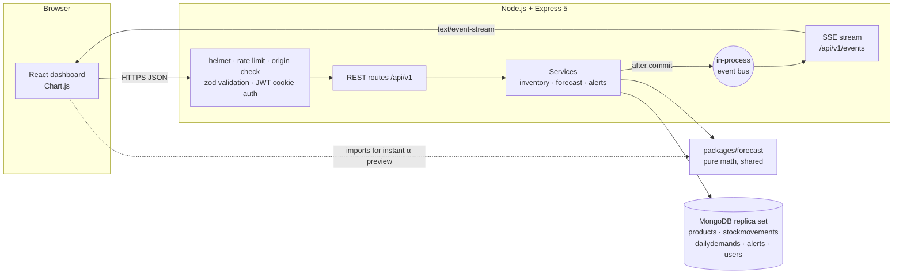

# Real-Time Inventory & Demand Forecasting API

A REST API and dashboard that tracks stock through an audited ledger and updates its demand forecast with every sale. Each forecast comes with a plain explanation, its measured accuracy, a reorder point and a suggested order quantity, and changes reach every open dashboard in real time.

## Architecture



## Features

- **Live forecasts:** each sale updates the forecast in constant time, with no history scan.
- **Four models, chosen automatically:** SMA, SES, Holt and Croston compete on a holdout for each product.
- **Explanations:** every forecast says why it changed, with weights, accuracy and confidence.
- **Reorder advice:** reorder points and order quantities come from the forecast and its uncertainty.
- **Cold start:** new products borrow a category average until they have their own history.
- **Safe stock changes:** stock, ledger, demand, forecast and alerts change in one transaction, and stock can never go negative.
- **Real-time dashboard:** server-sent events update stock, forecasts and alerts without a reload.
- **Roles:** admin, manager and supplier, with suppliers scoped to their own products.

The mathematics is written up in [docs/FORECASTING.md](docs/FORECASTING.md), and the API contract is in [docs/openapi.yaml](docs/openapi.yaml).

## Quick start

You need [Node.js 24](https://nodejs.org) and either Docker or your own MongoDB replica set.

### Option 1: Docker

```bash
docker compose up --build
```

In a second terminal, load the demo data:

```bash
npm ci
cp backend/.env.example backend/.env
npm run seed
```

Open <http://localhost:4000>.

### Option 2: Local development

```bash
npm ci
cp backend/.env.example backend/.env
docker compose up -d mongo
npm run seed
npm run dev
```

Open <http://localhost:5173>. To use your own MongoDB instead of the compose service, set `MONGODB_URI` in `backend/.env`. It must be a replica set, because stock changes use transactions.

`npm run seed` **drops and recreates the database** it points at. In production mode it only creates the first admin from `ADMIN_EMAIL` and `ADMIN_PASSWORD`, and adds no demo data.

### Seed logins

| Role | Email | Password |
|---|---|---|
| Admin | The `ADMIN_EMAIL` value (`admin@example.com` in `.env.example`) | The `ADMIN_PASSWORD` value (`change-me-admin-password` in `.env.example`) |
| Manager | `manager@example.com` | `demo-password-123` |
| Supplier | `supplier@example.com` | `demo-password-123` |

These accounts are for local demos only.

## Demo walkthrough

1. Sign in as the manager.
2. Pick **P101 Mechanical Keyboard**, the trending product. `auto` selects Holt, and the explanation says why.
3. Switch the method to `ses` and `sma`. Their forecasts fall behind the trend, and the holdout bias shows it.
4. Drag the α slider. The chart and explanation update instantly in the browser, with no network requests.
5. Open a second window signed in as the admin, and click **Simulate sale** in the first. The stock cell in the second window changes without a reload.
6. Pick **P110 Smart Desk Lamp**. It is only 5 days old, so it reports low confidence and leans on its category average.
7. Keep simulating sales, or record a large sale through the API. When stock crosses a reorder point, a toast appears in every open window.

## Environment variables

Set these in `backend/.env`.

| Variable | Example | Notes |
|---|---|---|
| `NODE_ENV` | `development` | `development`, `test` or `production` |
| `PORT` | `4000` | |
| `MONGODB_URI` | `mongodb://localhost:27017/inventory?directConnection=true` | Must be a replica set |
| `JWT_ACCESS_SECRET` | | At least 32 characters. Generate with `openssl rand -base64 48` |
| `JWT_REFRESH_SECRET` | | At least 32 characters, different from the access secret |
| `ACCESS_TOKEN_TTL` / `REFRESH_TOKEN_TTL` | `15m` / `7d` | |
| `APP_ORIGIN` | `http://localhost:5173` | Browser origin. Production needs `https`, except on loopback |
| `CORS_ORIGINS` | | Optional comma-separated list of extra origins |
| `TRUST_PROXY` | `0` | `1` behind one proxy |
| `STORE_TZ` | `UTC` | IANA zone that decides where a sales day ends |
| `SSE_MAX_CLIENTS` | `500` | |
| `LOG_LEVEL` | `info` | |
| `ADMIN_EMAIL` / `ADMIN_PASSWORD` | | Used by the seed script only |

The server refuses to start, and names the variable, if any of these are invalid. The defaults in `docker-compose.yml` are for local use, so set your own secrets for any shared deployment.

## Scripts

Run these from the repo root.

| Command | Purpose |
|---|---|
| `npm run dev` | Run the backend on :4000 and Vite on :5173 |
| `npm run build` | Build the frontend |
| `npm start` | Start the backend |
| `npm run lint` | Lint all workspaces |
| `npm test` | Run all tests |
| `npm run test:coverage` | Run all tests with coverage thresholds |
| `npm run seed` | Recreate the database with demo data |
| `npm run rebuild` | Recompute daily demand and forecast state from the ledger |
| `npm run docs:lint` | Lint the OpenAPI contract |

## Roles

| Capability | Admin | Manager | Supplier |
|---|---|---|---|
| View products, sales, forecasts and alerts | Yes | Yes | Own products only |
| View the ledger | Yes | Yes | No |
| Record stock movements | Yes | Yes | No |
| Edit product details and tune forecasts | Yes | Yes | No |
| Create and archive products | Yes | No | No |
| View suppliers | Yes | Yes | No |
| Create suppliers, manage users | Yes | No | No |

A supplier gets a 404, not a 403, for another supplier's product, so its existence is not revealed.

## Project structure

```
.
├── packages/forecast/   Pure forecasting functions, shared by server and browser
├── backend/
│   ├── src/
│   │   ├── routes/      Thin handlers: validate, authorize, call a service, respond
│   │   ├── services/    Inventory transactions, forecasts, alerts
│   │   ├── models/      Mongoose schemas
│   │   ├── middleware/  Auth, validation, origin check, rate limits, errors
│   │   └── lib/         Tokens, passwords, days, rounding, event bus
│   ├── scripts/         seed.js and rebuild.js
│   └── test/
├── frontend/src/        React dashboard
└── docs/                OpenAPI contract and forecasting write-up
```

## Testing

`npm test` runs everything with Vitest. No external services are needed, because the backend tests start their own in-memory MongoDB replica set, downloading the binary on first run.

- **Forecast package:** golden values, a property test that live and batch forecasts agree, and edge cases.
- **API:** every route, including role checks, supplier scoping, injection attempts, concurrent last-unit sales, idempotency, alerts, SSE delivery and listener leaks.
- **Frontend:** the legend, status badges, forecast panel, login errors, role-based controls and live updates.

## Known limitations

- **Single instance only:** the event bus lives in one process, so running several API instances would need a shared bus such as Redis pub/sub. `backend/src/lib/events.js` is the one file to change.
- **No purchase orders:** the system suggests order quantities but does not place orders.
- **No seasonality model:** weekly patterns are smoothed over, not modelled.
- **No back-dated sales through the API:** every movement is timestamped by the server.
- **Dashboard list size:** the dashboard loads the first 100 products.
- **Rate limits apply to the demo:** the global limit is 300 requests per 15 minutes per IP, and writes are limited to 120 per minute per user.
